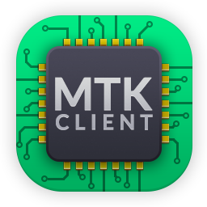

  Язык:
  <a title="English" href="./README.md">🇺🇸</a>
  <a title="Chinese" href="./README.zh-CN.md">🇨🇳</a>
  🇷🇺

# MTKClient

Простой mtk-инструмент для эксплойтов, чтения/записи флеш-памяти и прочих смелых экспериментов.
Для Windows нужно установить стоковый mtk-порт и драйвер usbdk (инструкции ниже).
Для Linux пропатченное ядро требуется только при использовании старого kamakiri (см. папку Setup) (кроме чтения/записи флеша).

Когда скрипт mtk запущен, загрузитесь в режим brom: выключите устройство, зажмите «громкость +» и питание либо «громкость −» и питание и подключите телефон. Когда инструмент обнаружит устройство, отпустите кнопки.

## MT6781, MT6789, MT6855, MT6886, MT6895, MT6983, MT8985
- Эти чипсеты используют новый протокол под названием V6, и их bootrom пропатчен.
Нужно использовать опцию --loader и подходящий загрузчик из каталога Loaders/V6.
Bootrom работать не будет — используйте режим preloader (аппаратные кнопки не нажаты, просто подключите устройство).
На некоторых устройствах preloader отключён, но его можно включить командой "adb reboot edl".

## Благодарности
- kamakiri [xyzz]
- linecode exploit [chimera]
- heapbait exploit [chimera], спасибо [R0rt1z2],[Shomy]
- Chaosmaster
- Geert-Jan Kreileman (GUI, дизайн и исправления)
- Всем контрибьюторам

### Установка

[Подсказки по установке на linux/macos](README-INSTALL.ru-RU.md)

[Подсказки по установке на windows](README-WINDOWS.ru-RU.md)

[Автоматический установщик для Windows](https://github.com/codefl0w/mtkclient-windows-installer)

### Использование
[Инструкции по использованию](README-USAGE.ru-RU.md)

### Готовый LiveDVD (всё готово к работе, на базе Ubuntu):
Пользователь: user, Пароль: user (на базе Ubuntu 22.04 LTS)

[Live DVD V6](https://www.androidfilehost.com/?fid=1109791587270922802)

### У меня проблемы ....... присылайте логи и полный вывод консоли !

- Запустите mtk-инструмент с --debugmode. Лог будет записан в log.txt (надеемся)

## Правила / Информация

### Детали / конфигурации чипов
- Смотрите config/brom_config.py
- Неизвестные usb vid/pid для автодетекта кладите в config/usb_ids.py

## Прочее
[Учебные материалы](learning_resources.ru-RU.md)
